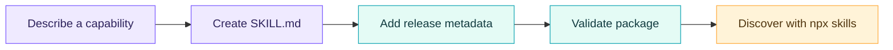

<div align="center">
  
  <h1>Skillify</h1>
  <p><strong>Build Agent Skills that follow the standard.</strong></p>
  <p>
    <a href="https://github.com/borg0ai/skillify/tags"></a>
    <a href="https://github.com/borg0ai/skillify/blob/main/LICENSE"></a>
    
    <a href="https://github.com/borg0ai/skillify"></a>
  </p>
  <p>
    
    
    
    
  </p>
</div>

Skillify helps you build skills that conform to the [Agent Skills specification](https://agentskills.io/specification). It guides the `SKILL.md` format and required metadata first, then checks Skillify's separate release-package conventions and verifies discovery with [`npx skills`](https://github.com/vercel-labs/skills).



## What Skillify helps with

| | Capability | Outcome |
| --- | --- | --- |
| 🟣 | **Build to standard** | Create a skill directory with valid `SKILL.md`, required `name` and `description`, focused instructions, and optional resources. |
| 🔵 | **Review** | Find spec mismatches, vague activation, hidden dependencies, broken references, and package clutter. |
| 🟢 | **Check packaging** | Validate Skillify's extra release metadata, version/channel consistency, links, and package boundary. |
| 🟠 | **Discover** | Confirm local skills appear in the `npx skills` installer. |

### Standard vs. Skillify conventions

The [Agent Skills specification](https://agentskills.io/specification) defines the skill format: a skill directory must contain `SKILL.md`, whose YAML frontmatter requires `name` and `description`. Optional directories such as `scripts/`, `references/`, and `assets/` hold resources used by the skill.

Skillify adds repository packaging rules: `skill-release.json`, release-channel/version consistency, and a clean installable directory. These are Skillify conventions, not Agent Skills standard fields. The local validator checks Skillify's supported subset; use `skills-ref validate <skill-directory>` for specification validation when `skills-ref` is installed.

## Install

Install Skillify for Codex:

```bash
npx skills add borg0ai/skillify --skill skillify --agent codex --copy --yes
```

Or list the skills in this repository:

```bash
npx skills add borg0ai/skillify --list
```

## Use

Ask your agent to create or review a skill, for example:

```text
$skillify Create a reusable skill for reviewing PostgreSQL migrations.
```

Skillify guides the agent to follow the Agent Skills specification first, then add Skillify release metadata, keep runtime files inside the skill folder, and check the package.

## Build a skill project

Single-skill repository layout:

```text
my-skill-project/
├── my-skill/
│   ├── SKILL.md
│   ├── skill-release.json
│   ├── LICENSE
│   ├── references/       # Optional, only when instructions link to them
│   └── scripts/          # Optional, only for needed executable helpers
├── README.md
└── test/                 # Outside installable skill directory
```

For multiple skills, place each package under `skills/<skill-name>/`. Keep tests, fixtures, dependency directories, build output, and repository-only docs outside every installable skill directory.

## Validate locally

Requirements: Node.js and pnpm.

```bash
pnpm install
pnpm check
npx skills add . --list
```

`pnpm check` runs the test suite and Skillify's package validator. For specification validation, run `skills-ref validate skillify` when `skills-ref` is installed. `npx skills add . --list` confirms installer discovery; it does not prove every agent will follow a skill's instructions correctly.

## Skill in this repository

[`skillify`](skillify/SKILL.md) helps create, review, and validate reusable Agent Skills.

## License

MIT. See [`LICENSE`](LICENSE).
